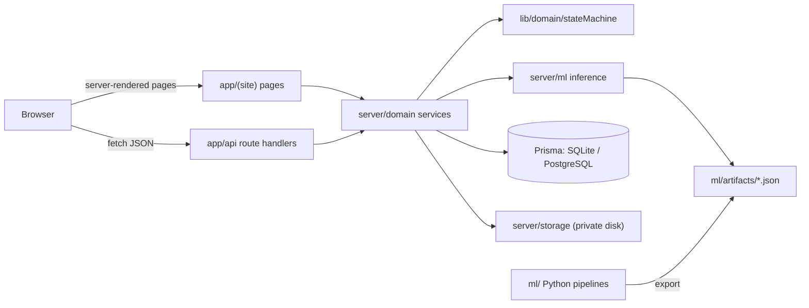

# Architecture

## Overview

A single Next.js 15 (App Router) application serves both the UI and a JSON API. Business rules live in one server-side domain layer that both the pages and the API call, so a rule is enforced in exactly one place.

## Layers

| Layer | Location | Responsibility |
|---|---|---|
| Pages | `app/(site)/**` | Server components load data through domain services and render; client components (`components/app/*`) handle interaction and call the API, then `router.refresh()` |
| API | `app/api/**/route.ts` | Thin handlers: authenticate (`requireActor`), parse JSON, call a domain function, return `{ data }` or `{ error: { code, message, details } }` |
| HTTP wrapper | `server/http.ts` | Same-origin check on every mutation, maps `ApiError` / Zod / Prisma errors to safe JSON, never returns stack traces |
| Auth | `server/auth/*`, `middleware.ts` | Random session token in an `HttpOnly`, `SameSite=Lax` cookie (Secure in production); only a SHA-256 hash is stored in `sessions`. Login is rate-limited per email and IP |
| Domain | `server/domain/*` | `applicant.ts` (create, update, upload, submit, resubmit, withdraw, alternative route), `officer.ts` (start review, assess, send review, decide, notes), `queries.ts` (scoped lists and the application view per audience), `accounts.ts` (register, login, profile, operator authorisation), `transition.ts` (the only code that changes `status`) |
| Shared rules | `lib/domain/*` | Constants, state machine table, Zod schemas, field definitions and document requirements, Indian state normalisation. Imported by both client and server |
| ML inference | `server/ml/*` | Loads exported tree JSON, encodes features exactly like the Python pipeline, predicts, evaluates the rule config, builds explanations |
| Storage | `server/storage.ts` | Uploads written under `UPLOAD_DIR` (default `storage/uploads`, outside `public/`), random file names, content checked by magic bytes, max 5 MB. Served only through `/api/documents/[id]` after an access check |

## Access control

Every read goes through `queries.ts`, which builds a Prisma `where` clause from the actor:

- **Farmer**: `farmerId = actor.id`.
- **Officer**: `route = actor.route` (from the officer's organisation assignment). Officers never see the other route.
- **Operator**: applications of farmers with an active, unexpired, unrevoked `OperatorAuthorization` for this operator.

Anything outside the scope returns **404** (not 403), so IDs of other people's applications cannot be probed. Pages use `loadViewOr404`, which turns those errors into the not-found page. The application view is shaped per audience: internal notes and officer names appear only for officers; operators do not see the farmer's phone.

## Concurrency and idempotency

- `applications.version` is incremented on every change. Mutations carry `expectedVersion`; `transition.ts` performs an `updateMany where { id, version }` and throws `409 STALE_VERSION` when no row matches. Two officers deciding at once therefore record exactly one decision (tested in Journey 8).
- Creating an application requires a client-generated `clientRequestId` (unique). A retried create returns the existing application instead of a duplicate.

## Internationalisation

`lib/i18n.ts` holds English and Hindi dictionaries; the language is a cookie read on the server (`getDict()`) and passed to client components through a provider. `<html lang>` follows the cookie.

## Security headers

`next.config.ts` sets a Content-Security-Policy (`default-src 'self'`, `frame-ancestors 'none'`, `object-src 'none'`), `X-Content-Type-Options: nosniff`, `X-Frame-Options: DENY`, `Referrer-Policy`, `Permissions-Policy`, removes `X-Powered-By`, and marks API responses `Cache-Control: no-store`. `script-src` allows `'unsafe-inline'` because Next.js injects inline bootstrap scripts and nonces are not configured.

## Database portability

The main schema (`prisma/schema.prisma`) uses SQLite and stores enumerations and JSON as strings so it is portable. `scripts/make-pg-schema.mjs` derives `prisma/postgres/schema.prisma` (provider `postgresql`), and `prisma/postgres/migrations` contains a migration generated from it. The Docker image generates the client from the PostgreSQL schema. See `DATABASE_SCHEMA.md`.

## Environments

| Environment | Database | Uploads | Build folder | Port |
|---|---|---|---|---|
| Development | `prisma/dev.db` | `storage/uploads` | `.next` | 3000 |
| Vitest | `prisma/test.db` | `storage/test-uploads` | — | — |
| Playwright | `prisma/e2e.db` | `storage/e2e-uploads` | `.next-e2e` | 3100 (3101 for the restart check) |
| Docker (unverified) | PostgreSQL 16 | volume `/data/uploads` | standalone | 3000 |
