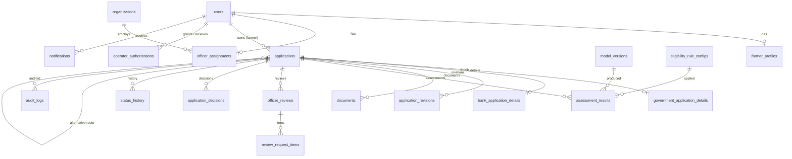

# Database schema

Source: `prisma/schema.prisma` (SQLite, used locally and in tests). `prisma/postgres/schema.prisma` is generated from it with only the provider changed. Enumerated values are stored as strings and validated in `lib/domain/constants.ts` and the Zod schemas; JSON is stored as text. This keeps one schema valid on both databases.

## Tables (22)

| Table | Purpose | Key columns / constraints |
|---|---|---|
| `users` | All accounts | `email` unique, `role` (FARMER, GOV_OFFICER, BANK_OFFICER, OPERATOR), bcrypt `passwordHash`, `isActive` |
| `sessions` | Login sessions | `tokenHash` unique (SHA-256 of the cookie token), `expiresAt` |
| `rate_limit_hits` | Login, registration and code rate limiting | `key`, `createdAt` (indexed) |
| `farmer_profiles` | Reusable farmer details for prefill | `userId` unique; state stored as a normalised code |
| `organizations` | Government department and demo bank | `code` unique, `route` |
| `officer_assignments` | Links an officer to an organisation (and therefore a route) | `userId` unique |
| `assistance_codes` | One-time codes a farmer gives a service centre | `codeHash`, `expiresAt` (30 min), `usedAt` |
| `operator_authorizations` | Consent for an operator to act for a farmer | `consentMethod`, `consentText` (the statement the operator confirmed), `grantedAt`, `expiresAt` (24 h), `revokedAt` |
| `applications` | One financing application | `reference` unique, `clientRequestId` unique (idempotency), `status`, `version` (optimistic locking), `currentRevisionNo`, `submissionMethod`, `assistedByOperatorId`, `parentApplicationId` (alternative route), `prefillConsentAt`; indexes on `(route, status)` and `farmerId` |
| `government_application_details` | Government form fields | `applicationId` unique; all fields nullable so drafts can be partial |
| `bank_application_details` | Bank form fields | `applicationId` unique |
| `application_revisions` | Snapshot of details and document list at each submission | `(applicationId, revisionNo)` unique |
| `documents` | Uploaded files (metadata only; files on private disk) | `storedName` (random, unique), `originalName`, `sha256`, `mimeType`, `sizeBytes`, `revisionNo`, `supersededAt` (replaced files are kept for the audit trail) |
| `model_versions` | Registered ML artifacts | `version` unique, `algorithm`, `checksum`, `metrics` |
| `eligibility_rule_configs` | Versioned rule thresholds | `version` unique |
| `assessment_results` | Each model run | `outcome`, `score`, `ruleResults`, `explanation`, `suggestions`, `revisionNo`, `isStale`, model and rule version |
| `officer_reviews` | Structured reviews sent to the farmer, and internal notes | `kind` (CHANGES_REQUESTED / INTERNAL_NOTE), `summary`, `nextSteps`, `deadline` |
| `review_request_items` | Individual requested changes | `itemType` (FIELD / DOCUMENT / GENERAL), `fieldKey`, `documentType`, `farmerResponse`, `resolvedInRevisionNo`, `resolvedAt` |
| `application_decisions` | Approve / reject / escalate | `decision`, `reason`, `conditions`, `overridesAssessment`, `assessmentId`, `revisionNo`; one final decision per application |
| `status_history` | Every status change | `fromStatus`, `toStatus`, actor, note, `revisionNo` |
| `notifications` | In-app notifications | `userId`, `readAt`, `dedupeKey` unique (no duplicate notification for the same event) |
| `audit_logs` | Append-only audit trail | actor, `action`, entity type and id, `metadata` |

## Relationships



## Migrations

| Database | Location | How it is applied |
|---|---|---|
| SQLite | `prisma/migrations/` | `npm run db:deploy` (or `npm run setup`) |
| PostgreSQL | `prisma/postgres/migrations/` | `prisma migrate deploy --schema prisma/postgres/schema.prisma` (run automatically when the Docker container starts) |

After changing `prisma/schema.prisma`:

```bash
npm run db:migrate                     # new SQLite migration
npm run db:pg-schema                   # regenerate prisma/postgres/schema.prisma
npx prisma migrate diff --from-migrations prisma/postgres/migrations --to-schema-datamodel prisma/postgres/schema.prisma --shadow-database-url <postgres-url> --script > prisma/postgres/migrations/<timestamp>_<name>/migration.sql
```

The initial PostgreSQL migration was generated offline with `prisma migrate diff --from-empty`. It has **not** been applied to a real PostgreSQL server (none was available).

## Data safety

- Database files (`prisma/*.db`) and uploads (`storage/`) are git-ignored.
- Seed data is synthetic: invented names, `@demo.in` emails, sample PDFs. No identity numbers or bank credentials are stored anywhere in the schema.
- Throwaway databases for tests are recreated by deleting the file (`scripts/fresh-db.mjs`), which refuses to touch `dev.db` without `--allow-dev`.
