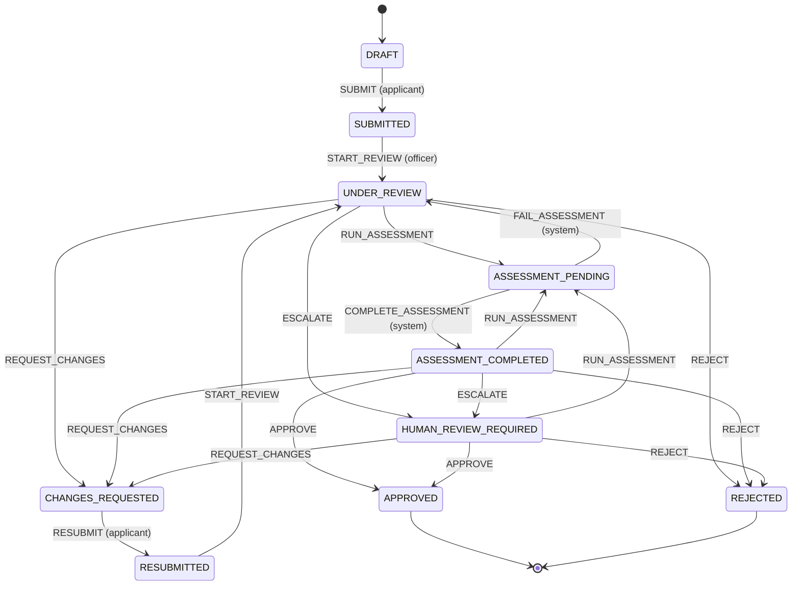

# Workflow specification

The single source of truth is `lib/domain/stateMachine.ts` (`TRANSITIONS`). The backend rejects any change not in the table (`409 INVALID_TRANSITION`), and only `server/domain/transition.ts` writes `applications.status`.

## States

| Status | Meaning | Who acts next |
|---|---|---|
| `DRAFT` | Being filled in; saved on every step | Farmer / operator |
| `SUBMITTED` | Sent; waiting in the officer queue ("New") | Officer |
| `UNDER_REVIEW` | Officer has opened it | Officer |
| `ASSESSMENT_PENDING` | Model running (transient, inside one transaction) | System |
| `ASSESSMENT_COMPLETED` | Model result and rule checks stored | Officer |
| `CHANGES_REQUESTED` | Officer sent a structured review ("SEND REVIEW TO FARMER") | Farmer / operator |
| `RESUBMITTED` | Farmer corrected and resubmitted; a new revision exists | Officer |
| `HUMAN_REVIEW_REQUIRED` | Escalated for a senior or manual check | Officer |
| `APPROVED` | Final (demonstration only — no real sanction or disbursement) | — |
| `REJECTED` | Final, with a reason shown to the farmer; "EXPLORE OTHER FINANCING ROUTE" offered | Farmer may start the other route |
| `WITHDRAWN` | Withdrawn by the farmer | — |

## Transitions

Any non-final, non-transient state can move to `WITHDRAWN` by the applicant (`DRAFT`, `SUBMITTED`, `UNDER_REVIEW`, `ASSESSMENT_COMPLETED`, `CHANGES_REQUESTED`, `RESUBMITTED`, `HUMAN_REVIEW_REQUIRED`). Operators cannot withdraw on a farmer's behalf.

Approval requires a current (non-stale) assessment. Approving against an assessment that is not `ELIGIBLE` requires an override reason of at least 15 characters, which is stored on the decision and shown to auditors. Reject and escalate require a reason of at least 10 characters.

## Every transition

Inside one database transaction:

1. Check the action is allowed from the current status for the actor type.
2. Update the application where `version = expectedVersion`; otherwise `409 STALE_VERSION`.
3. Insert a `status_history` row (from, to, actor, note).
4. Insert an `audit_logs` row.
5. Insert a notification for the farmer when the change affects them (submitted, under review, changes requested, decided).

## Structured review and correction

1. The officer composes a review: summary, optional next steps and deadline, and 1–20 items. Each item targets a **field** (`fieldKey`), a **document** (`documentType`) or is **general**.
2. Sending it creates `officer_reviews` + `review_request_items` and moves the application to `CHANGES_REQUESTED`.
3. The farmer's detail page shows an "Action required" banner. In the form, the requested fields and documents are highlighted with the officer's message.
4. On resubmission the server compares the new details and documents with the previous revision. A field item is resolved if the field changed; a document item is resolved if a document of that type was uploaded since the review. Items that were not changed need a written farmer response, otherwise resubmission is refused with the list of unresolved items.
5. A new `application_revisions` row is stored, and earlier assessments are marked **stale**. The officer sees a "Resubmitted" alert, highlighted changed fields, and a side-by-side revision comparison.

## Alternative route

After `REJECTED`, `WITHDRAWN`, or a `NOT_ELIGIBLE` assessment, the farmer may "EXPLORE OTHER FINANCING ROUTE". A dialog lists the shared fields (name, age, state, district, village, land) and optional fields; only the ones the farmer ticks are copied, and the consent time is recorded (`prefillConsentAt`). The new application is a draft linked to the original (`parentApplicationId`). Only one active alternative per application is allowed.

## Assisted submission

1. The farmer creates a 6-digit one-time code on their profile (valid 30 minutes, stored hashed, single use).
2. The operator enters the farmer's email and the code and must tick the consent statement.
3. An `operator_authorizations` row is created (expires after 24 hours, revocable by the farmer at any time).
4. Applications started by the operator are owned by the farmer, marked `ASSISTED`, and record the operator and authorisation. Every operator action is audited. Revoking the authorisation removes the operator's access immediately.
